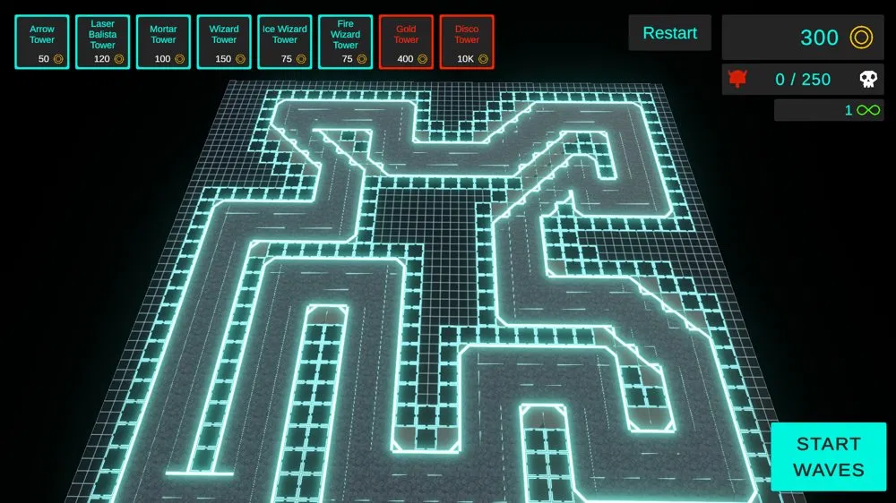
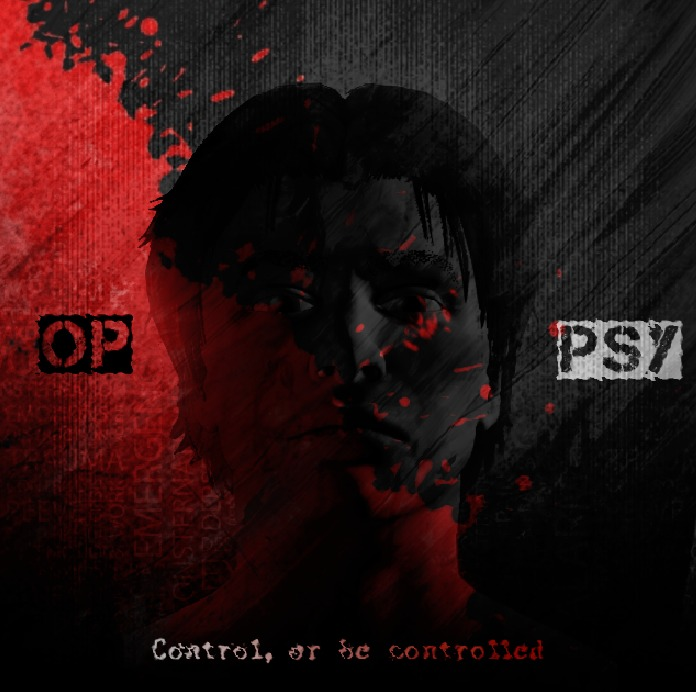

<h1 align="left">Hi, I'm Eduard Engelbrecht 👋</h1>

  Software developer in Pretoria, South Africa. I build C# and .NET backends and real-time 3D tools at Cartrack, and I'm finishing my BComp at Belgium Campus iTversity (April 2027). I also make games in Unity, Godot and Unreal Engine.

  🌐 <a href="https://eduardengelbrecht.com">eduardengelbrecht.com</a>

###

  
  

###

## What I'm working on

- Building an enterprise 3D simulation and monitoring tool with a Godot 4 and C# front end and ASP.NET Core (.NET 8) APIs (proprietary, so no public code)
- A dissertation on modelling player retention in digital games with explainable machine learning (in progress)
- Learning TypeScript, Angular, React, SignalR, RabbitMQ and Kafka

## Projects

- **Student Management System**: C# and Windows Forms app for student record CRUD operations and GPA calculation
- **E-Commerce Platform**: Node.js and MongoDB store with full CRUD, cart and checkout logic, and product admin control
- **ML Inventory Demand Forecasting**: Python regression model that forecasts product demand and optimises restocking

## Games

<table>
  <tr>
    <td align="center" width="33%">
      
       <b>Tower Defence</b>
       Unity · Team project · I contributed to this game
    </td>
    <td align="center" width="33%">
      
       <b>Adventure Platformer</b>
       Unity · Team project · I contributed to this game
    </td>
    <td align="center" width="33%">
      
       <b>OPPSY</b>
       Godot · Built with my brother · In development
    </td>
  </tr>
</table>

###

## Tech I work with

  
  
  
  
  
  
  
  
  
  
  
  
  
  
  
  
  

 

  
  
  
  
  
  
  
  
  
  
  
  
  
  
  

 

  
  
  
  
  
  
  
  
  
  
  
  
  
  
  
  
  

###

## Get in touch

  
  
  

